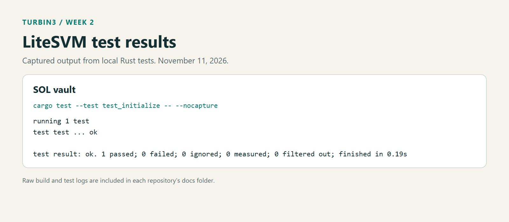

# SOL Vault

My Turbin3 Week 2 vault assignment, built from the course starter. Each user gets a SOL vault PDA and a separate state PDA. The user can deposit SOL, withdraw it, and close the vault.

## Instructions

| Instruction | What it does |
| --- | --- |
| `initialize()` | Creates the user's state account, saves both PDA bumps, and funds the vault's rent reserve. |
| `deposit(amount)` | Transfers SOL from the signing user to their vault. The amount must be positive. |
| `withdraw(amount)` | Returns SOL to the signing user, keeping the vault's rent reserve. The amount must be positive and within the available balance. |
| `close()` | Returns all remaining vault SOL and closes the state account, returning its rent too. |

Amounts are in lamports: 1 SOL is 1,000,000,000 lamports.

## Accounts and authority

| Account | PDA seeds | Purpose |
| --- | --- | --- |
| `vault_state` | `[b"state", user_public_key]` | Stores the state and vault bumps. Owned by this program. |
| `vault` | `[b"vault", user_public_key]` | Holds SOL. Owned by the System Program. |

The user's signature and the PDA constraints bind each operation to that user's accounts. Deposits use the user's signature. For withdrawals and closure, the program supplies the vault's seeds and bump when calling the System Program.

The vault retains its rent reserve during withdrawals. `close` returns that reserve along with any remaining deposit. This is a SOL storage exercise; funds are not invested in a lending market or represented by position tokens.

## Build and test

The project uses Anchor 1.1.2, LiteSVM 0.10.0, and Rust 1.89.0. Install the Anchor CLI and Solana SBF build tools, then run from the repository root:

```sh
anchor build
cargo test --test test_initialize -- --nocapture
```

Build first because the test embeds `target/deploy/q3_26_vault.so` at compile time. No running validator is needed.

The single lifecycle test in [test_initialize.rs](programs/q3_26_vault/tests/test_initialize.rs) executes all four instructions:

1. Initialize the state and check the vault's rent reserve.
2. Deposit 500,000,000 lamports (0.5 SOL).
3. Withdraw 100,000,000 lamports (0.1 SOL).
4. Close the vault and check that the state is gone and the vault is empty.



[Full test output](docs/test-output.txt)

## What I learned

The account holding SOL and the account storing program state have different owners and jobs. A PDA does not have a private key: the program authorizes its transfers through matching seeds in a CPI. Closing also needs to account for both the remaining deposit and account rent.

Withdrawal uses checked subtraction when calculating the balance above the rent reserve. The current test verifies the successful lifecycle; it does not separately test unauthorized users, invalid amounts, or withdrawing the full available balance.
